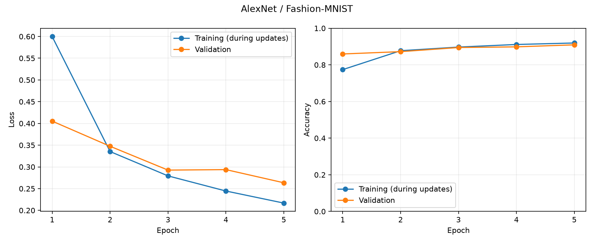

# 第四阶段基线实验记录

运行日期：2026-11-12。本次用于验证完整训练流程，并为下一阶段的对照实验提供参考。

## 固定配置

- 模型：手写 AlexNet-FashionMNIST-96，4,516,554 个参数。
- 训练 54,000 张、验证 6,000 张，分层划分种子 42；训练随机种子 42。
- Adam，学习率 0.0003，weight_decay=0；batch_size=64；5 个 epoch。
- 不使用 BN，Dropout=0；无数据增强，所有集合使用同一固定预处理。
- 按验证准确率最高选最佳；准确率相同则选择验证损失更低的轮次。
- CUDA / NVIDIA GeForce RTX 3050 Ti Laptop GPU；总用时约 108.76 秒。

## 实际结果

最佳检查点：第 5 轮。下面的两个准确率使用同一个最佳模型，在 eval/no_grad 模式下重新计算。

| 集合 | 正确 / 总数 | 准确率 | 平均交叉熵 |
| --- | --- | --- | --- |
| 训练 | 50,556 / 54,000 | 93.6222% | 0.173311 |
| 验证 | 5,456 / 6,000 | 90.9333% | 0.263505 |
| 测试 | 尚未评估 | — | — |

独立评估命令重新加载检查点后，完整验证集指标与训练结束时一致。
检查点 SHA-256 保存在 `best_val_evaluation.json`。

验证成绩超过 90% **不等于** 已满足作业要求的测试成绩超过 90%。
为了保留独立测试，本阶段没有读取测试集；后续先完成验证集上的参数选择和对照设计。

## 如何理解曲线



训练损失从 0.599806 降至 0.216771，验证准确率从 85.95% 升至 90.9333%。
第 4 轮验证损失略有上升，而准确率仍上升：损失还受到预测置信程度影响，
它与“分类是否正确”的准确率并不是同一个指标。

图中的训练准确率是每个批次更新前统计后累计的结果，第 5 轮为 91.9426%。
最终训练准确率 93.6222% 则是训练结束后用固定的最佳权重重新遍历训练集得到的。
两者统计时的模型状态不同，因此数值不同，不应混为一谈。

这只有一个种子的一次短训练，尚不能据此判断 BN、Dropout 或动量孰优孰劣。

## 文件与复现

- `config.json`：完整超参数；`metadata.json`：环境、划分哈希与源文件哈希。
- `history.json` / `history.csv`：每轮指标、实际样本数、学习率和耗时。
- `metrics.json`：最佳模型的最终训练/验证评估。
- `status.json`：运行完成状态。
- `best_val_evaluation.json`：独立加载权重后的验证集结果。
- 本地权重位于 `outputs/stage4_baseline_5epochs/best.pt` 和 `last.pt`，不进入 Git。

在项目根目录运行；使用新实验名，避免覆盖原始记录：

```powershell
.\.venv\Scripts\python.exe -m src.train --config configs/baseline.json --run-name stage4_repeat --device cuda
.\.venv\Scripts\python.exe -m src.evaluate outputs/stage4_repeat/best.pt --split val --device cuda
```

固定种子有助于同环境复现，但不同软硬件环境不保证逐位相同。时间戳日志使用 UTC。
