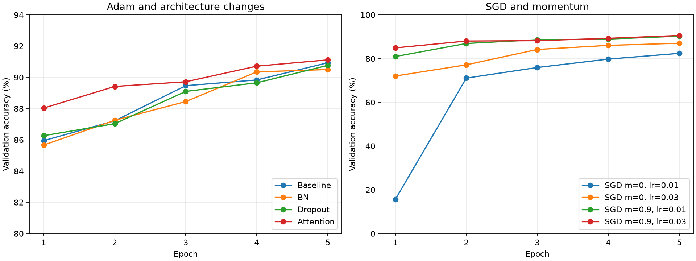

# 第五阶段对照实验结果

验证集选出的最终模型是自注意力版 AlexNet 的第 10 轮检查点。它在官方测试集上正确分类 **9,201／10,000 张，准确率 92.01%**，超过 90% 的作业目标。完整训练集准确率为 96.84%（52,296／54,000），验证集为 92.00%（5,520／6,000）。

训练与验证使用相同的固定分层划分和批次大小 64，训练种子与划分种子均为 42。5 轮对照使用相同训练预算。12 轮候选从头训练，训练配置取自 5 轮验证成绩最高的组。检查点按验证准确率和验证损失选出，随后核对权重 SHA-256 并统一测试。选择顺序和权重哈希见 [selection.json](selection.json)。

| 运行 | 配置差异 | 训练准确率 | 验证准确率 | 测试准确率 | 测试较基线（百分点） |
| --- | --- | ---: | ---: | ---: | ---: |
| 基线 | Adam，学习率 0.0003 | 93.62% | 90.93% | 91.41% | 0.00 |
| BN | Adam，开启 BN | 93.34% | 90.50% | 90.90% | −0.51 |
| Dropout | Adam，Dropout=0.5 | 93.07% | 90.77% | 90.77% | −0.64 |
| 自注意力 | Adam，替换第一段全连接分类头 | 94.26% | 91.12% | 91.36% | −0.05 |
| SGD | 学习率 0.01，动量 0 | 83.04% | 82.40% | 81.87% | −9.54 |
| SGD | 学习率 0.03，动量 0 | 88.86% | 87.02% | 87.33% | −4.08 |
| SGD + 动量 | 学习率 0.01，动量 0.9 | 92.91% | 90.25% | 90.90% | −0.51 |
| SGD + 动量 | 学习率 0.03，动量 0.9 | 92.96% | 90.57% | 90.70% | −0.71 |
| 最终候选 | 自注意力配置训练 12 轮，取第 10 轮 | **96.84%** | **92.00%** | **92.01%** | **+0.60** |

每列准确率均由同一行的最佳权重在评估模式下计算。其中测试集每组均为 10,000 张。各组配置、准确率、正确数、损失、耗时及相对百分比见 [comparison.csv](comparison.csv)。九个运行均完成，低分的 SGD 尝试一并保留。全部来自单一种子，百分点差异不代表统计显著性。

1. **BN**。BN 组第一轮训练过程的准确率为 84.76%，基线为 77.40%，第 4 轮验证成绩也略高。到第 5 轮，它的最终训练准确率比基线低 0.28 个百分点，验证和测试分别低 0.43、0.51 个百分点。这组配置下，前期训练过程的提升没有持续到最佳检查点的评估结果。
2. **Dropout**。概率 0.5 使固定权重的训练、测试准确率分别下降 0.55、0.64 个百分点。短程结果表明这档正则强度未带来收益。若继续研究，可用同预算比较更低的丢弃率并重复种子。
3. **SGD 动量**。学习率固定为 0.01 时，加入动量让验证准确率从 82.40% 升至 90.25%，测试从 81.87% 升至 90.90%。固定为 0.03 时，验证从 87.02% 升至 90.57%，测试从 87.33% 升至 90.70%。两组都按验证集选择 0.03；同学习率比较支持本次训练预算下动量改善 SGD 优化的结论。
4. **自注意力**。5 轮时验证准确率高 0.18 个百分点，测试低 0.05 个百分点，仅相差 5 张图。参数从 4,516,554 降到 4,125,386，少约 8.66%，整次 5 轮运行约 115 秒，基线约 109 秒。替换也改变了空间池化方式和全连接输入宽度。最终候选多训练了数轮，92.01% 的结果包含训练时长和分类头两方面的差异。若要进一步判断长训下的结构收益，可加同预算线性基线和多种子重复。

最终候选的完整曲线见 [finalist_learning_curves.png](finalist_learning_curves.png)。第 10 轮验证最优，最后一轮为 91.75%，所以测试读取 `best.pt`。

配置与逐轮日志保存在 `runs/<实验名>/`。权重保存在本地 `outputs/<实验名>/`。运行命令与函数讲解见[第五阶段教程](../../docs/05_experiments.md)。训练记录中的 `metrics.json` 是测试前的快照，测试结果对应独立的 `best_test_evaluation.json`。
